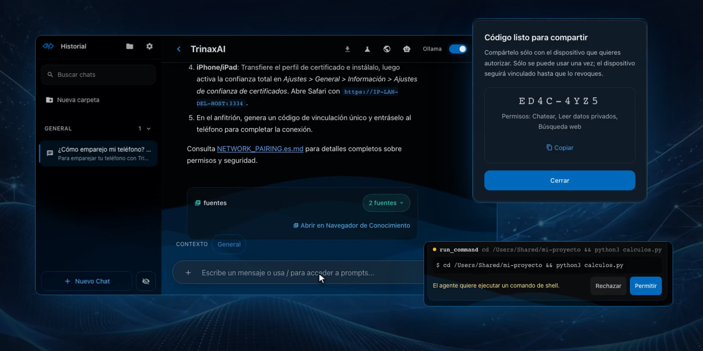
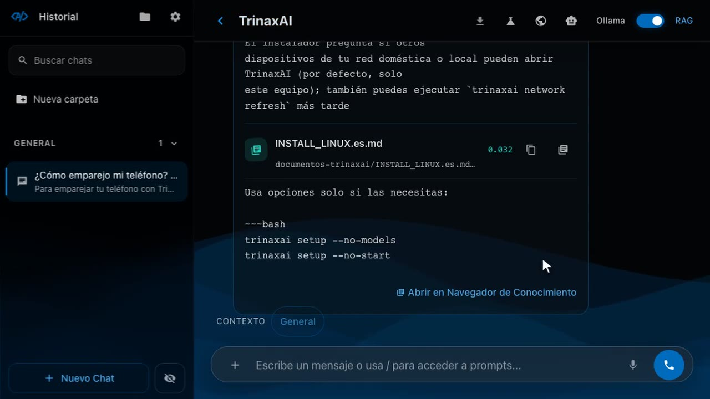
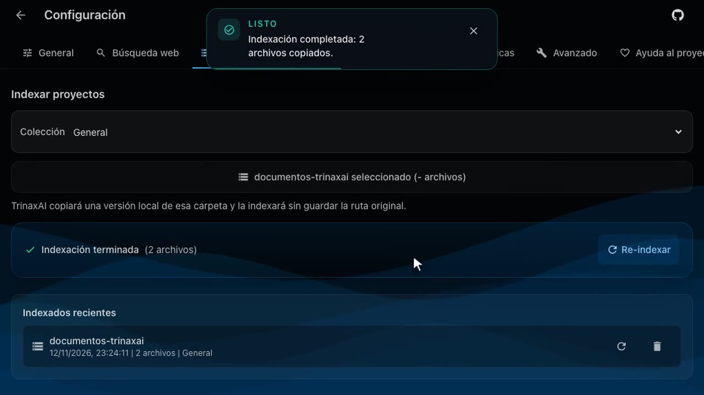
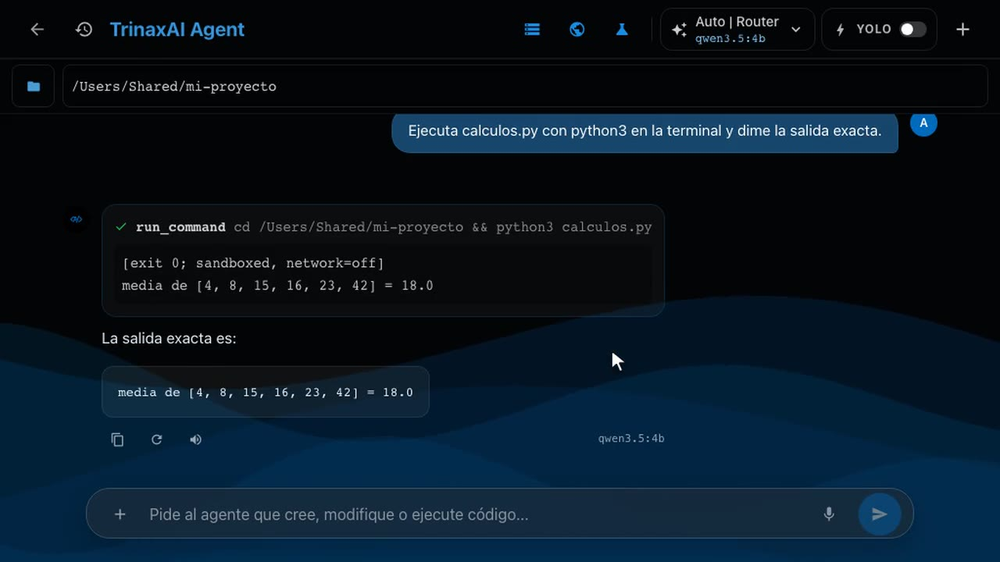
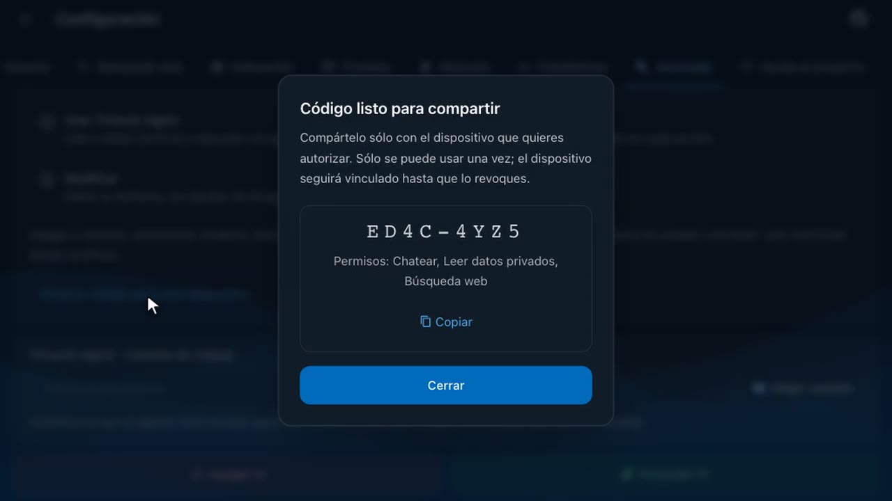

<h1 align="center">
  <a href="https://github.com/TrinaxCode/TrinaxAI"></a>
</h1>

<p align="center">
  <a href="https://github.com/TrinaxCode/TrinaxAI"></a>
  <a href="https://github.com/TrinaxCode/TrinaxAI/releases/tag/v1.4.1"></a>
  <a href="https://www.npmjs.com/package/trinaxai"></a>
  <a href="https://github.com/TrinaxCode/TrinaxAI/actions/workflows/ci.yml"></a>
  <a href="https://github.com/TrinaxCode/TrinaxAI/blob/main/LICENSE"></a>
  
</p>

<p align="center"><sub><a href="README.md">English</a> · <strong>Español</strong></sub></p>

<p align="center">
  <strong>Un asistente privado y local para tus archivos, investigaciones y código.</strong><br/>
  Pregunta y recibe respuestas que citan el archivo de origen, indexa carpetas, deja que un agente de código trabaje en un workspace que apruebas y empareja tu móvil. Todo se ejecuta en tu propio equipo.
</p>

<h3 align="center"><a href="#instalar"><ins>Instalar TrinaxAI</ins></a> &nbsp;·&nbsp; <a href="docs/README.es.md"><ins>Documentación</ins></a></h3>

<p align="center">
  
</p>

```bash
npm install -g trinaxai@latest
trinaxai setup
```

TrinaxAI mantiene la inferencia y los datos indexados en el host configurado
salvo que elijas explícitamente un servicio remoto. Combina chat local,
generación aumentada por recuperación (RAG) con citas, investigación web
opcional, un agente de código confinado al workspace, una interfaz de terminal y
una aplicación web progresiva (PWA) instalable.

## Funciones

<table>
<tr>
<td width="38%" valign="middle">

### Pregunta a tus archivos

Pregunta en lenguaje natural y recibe una respuesta que cita el archivo de donde sale. Abre la fuente citada para comprobarla antes de fiarte de la respuesta.

[Docs →](docs/CLI_REFERENCE.es.md#chat-y-consultas)

</td>
<td width="62%">
  <a href="docs/CLI_REFERENCE.es.md#chat-y-consultas"><picture><source srcset="docs/assets/readme/features/ask.es.webp" type="image/webp"></picture></a>
</td>
</tr>
<tr>
<td width="38%" valign="middle">

### Indexa una carpeta

Apunta TrinaxAI a una carpeta y sigue su progreso medido paso a paso. Reindexar es incremental, así que solo se vuelve a procesar lo que cambió.

[Docs →](docs/CLI_REFERENCE.es.md#indexación-y-exploración)

</td>
<td width="62%">
  <a href="docs/CLI_REFERENCE.es.md#indexación-y-exploración"><picture><source srcset="docs/assets/readme/features/index.es.webp" type="image/webp"></picture></a>
</td>
</tr>
<tr>
<td width="38%" valign="middle">

### Un agente que pregunta primero

Un agente de código que trabaja en un workspace que apruebas. Las acciones peligrosas esperan tu Permitir o Rechazar. Su herramienta de terminal se ejecuta en un sandbox del sistema sin red (bubblewrap en Linux, Seatbelt en macOS) y permanece desactivada en Windows; las herramientas de archivos funcionan en todas.

[Guía de seguridad →](docs/SECURITY.es.md)

</td>
<td width="62%">
  <a href="docs/SECURITY.es.md"><picture><source srcset="docs/assets/readme/features/agent.es.webp" type="image/webp"></picture></a>
</td>
</tr>
<tr>
<td width="38%" valign="middle">

### Úsalo desde tu móvil

Activa el acceso por red, genera un código de un solo uso en el host y empareja otro dispositivo. Cada dispositivo recibe solo los permisos que concedas, y puedes revocarlo después.

[Pairing LAN →](docs/NETWORK_PAIRING.es.md)

</td>
<td width="62%">
  <a href="docs/NETWORK_PAIRING.es.md"><picture><source srcset="docs/assets/readme/features/pair.es.webp" type="image/webp"></picture></a>
</td>
</tr>
</table>

<sub>Las animaciones son grabaciones reales de la app web de TrinaxAI, aceleradas en los tramos de espera. Los modelos locales pequeños pueden equivocarse; consulta los [límites conocidos](#límites-conocidos).</sub>

**También incluye:**

- **[Modelos locales a la medida de tu equipo](#modelos-y-hardware)**: la configuración detecta CPU, memoria, GPU y VRAM y elige un perfil `8gb`, `16gb`, `32gb` o `64gb`. El perfil `8gb` funciona solo con CPU.
- **Enrutamiento por tipo de tarea**: chat local con Ollama y enrutamiento para chat, código, razonamiento y matemáticas.
- **RAG híbrido**: búsqueda sobre código y documentos con citas, colecciones e indexación incremental.
- **Investigación profunda**: `trinaxai research "..." --depth 2`; añade `--web` para apoyarla en búsqueda web.
- **Búsqueda web, memoria, voz y visión**: todo opcional.
- **Una interfaz de terminal**: chat, indexación, investigación, diagnósticos y exportaciones desde cualquier directorio.
- **Una PWA instalable**: HTTPS, para escritorio y móvil, con emparejamiento por scopes.
- **Español e inglés**: el instalador y la app.
- **Comprobaciones de salud**: `trinaxai doctor` y `trinaxai status` revisan la instalación y sus servicios.

---

## Modelos y hardware

La configuración elige un perfil según la memoria y los recursos gráficos:

| Perfil | Chat y código | Respuestas rápidas | Embeddings |
| --- | --- | --- | --- |
| `8gb` | `qwen3.5:2b` | `qwen3.5:2b` | `qwen3-embedding:0.6b` |
| `16gb` | `qwen3.5:4b` | `qwen3.5:2b` | `qwen3-embedding:0.6b` |
| `32gb` | `qwen3.5:9b` | `qwen3.5:4b` | `qwen3-embedding:4b` |
| `64gb` | `qwen3.5:35b` / `qwen3-coder:30b` | `qwen3.5:4b` | `qwen3-embedding:4b` |

El perfil `8gb` funciona solo con CPU. Consulta la
[referencia de configuración](docs/CONFIGURATION.es.md) para modelos y recursos.

---

## Instalar

Usa el paquete npm en Linux, macOS o Windows. Necesitas Node.js 22 o posterior
con npm disponible en la terminal.

~~~bash
npm install -g trinaxai@latest
trinaxai setup
~~~

El lanzador descarga el release oficial correspondiente, verifica su checksum
SHA-256 e inicia la configuración de la plataforma. El flujo prepara el
backend, la PWA, Ollama y los modelos recomendados.

La instalación empieza con una bienvenida y te pregunta el idioma (español o
inglés). Luego comprueba el espacio en disco y la conexión, te hace todas las
preguntas opcionales al principio (descargar modelos, iniciar ahora,
autoarranque, comprobación semanal de actualizaciones, acceso desde otros
dispositivos) y muestra un plan de
instalación para que lo confirmes antes de cambiar nada. Ejecuta `trinaxai setup`
de nuevo sobre una instalación existente para repararla, actualizarla o
desinstalarla.

El lanzador npm es la única ruta de instalación pública para usuarios finales.
Los scripts de plataforma del repositorio implementan el release por debajo;
no necesitas descargarlos ni ejecutarlos directamente.

### Opciones de configuración

| Necesidad | Comando |
| --- | --- |
| Aplazar modelos | `trinaxai setup --no-models` |
| Preparar sin iniciar servicios | `trinaxai setup --no-start` |
| Permitir que otros dispositivos de tu red abran TrinaxAI (por defecto: solo este equipo) | `trinaxai setup --lan-access` |
| Elegir un perfil | `trinaxai setup --profile 16gb` |
| Previsualizar cambios | `trinaxai setup --dry-run` |
| Omitir la pregunta de idioma | `trinaxai setup --language es` |
| Automatizar | `trinaxai setup --yes` (o `--non-interactive`) |

Consulta [configuración](docs/CONFIGURATION.es.md) para ajustar modelos, límites
o proveedores.

### Empezar a usar TrinaxAI

Ejecuta primero la comprobación de salud:

~~~bash
trinaxai doctor
trinaxai status
~~~

Después abre [https://localhost:3334](https://localhost:3334). El navegador
puede pedirte que confíes en el certificado local la primera vez.

Haz una pregunta sobre los archivos indexados:

~~~bash
trinaxai ask "Resume mi proyecto indexado" --engine rag
~~~

Si aplazaste la descarga de modelos, ejecuta `trinaxai setup` cuando estés
listo. Usa `trinaxai --help` para consultar todos los comandos.

### Comandos diarios

Usa la CLI desde cualquier directorio después de la instalación:

| Objetivo | Comando |
| --- | --- |
| Abrir el asistente interactivo | `trinaxai chat` |
| Hacer una pregunta | `trinaxai ask "..." --engine rag` |
| Indexar una carpeta | `trinaxai index ./documentos` |
| Ejecutar investigación (añade `--web` para apoyarla en búsqueda web) | `trinaxai research "..." --depth 2` |
| Usar el agente | `trinaxai agent --workspace .` |
| Revisar servicios | `trinaxai status` |
| Ver o cambiar quién puede abrir TrinaxAI | `trinaxai network` / `trinaxai network off` |
| Iniciar o detener servicios | `trinaxai start` / `trinaxai stop` |
| Diagnosticar | `trinaxai doctor --strict` |
| Actualizar | `trinaxai update` |
| Eliminar TrinaxAI | `trinaxai uninstall` |

---

## Límites conocidos

- Preguntas sobre código respondidas por modelos locales pequeños: las fuentes
  citadas a veces son erróneas o incompletas, así que abre el archivo citado
  antes de fiarte de una respuesta.
- `trinaxai research` es lento en un equipo sin GPU.
- No medido: el flujo completo (instalación, chat, RAG, agente y app web) en
  Windows, con GPU y con modelos grandes. macOS y Windows están cubiertos por las
  comprobaciones automáticas de CI, no por ejecuciones de extremo a extremo.

## Privacidad y seguridad

TrinaxAI enlaza los servicios locales a loopback por defecto. Ollama no se
expone como proxy genérico. Los navegadores LAN deben emparejarse con un código
de un solo uso y reciben únicamente las capacidades que concedas, dispositivo por
dispositivo. Puedes permitir que un dispositivo concreto indexe, use el Agente o
modifique datos; el apagado, la gestión de modelos, el emparejamiento de
dispositivos, el restablecimiento de fábrica y la autoaprobación del Agente
(YOLO) siempre siguen siendo solo del host.

Mantén privados los puertos `3333` y `11434`, protege `storage/.proxy_secret` y
usa una VPN en vez de exponer el host a Internet. Lee la
[guía de seguridad](docs/SECURITY.es.md) y la [guía de pairing LAN](docs/NETWORK_PAIRING.es.md)
antes de conectar otro dispositivo.

---

## Documentación

| Quieres… | Consulta |
| --- | --- |
| Instalar, actualizar o eliminar | [Centro de documentación](docs/README.es.md) |
| Configurar modelos, RAG, red o límites | [Configuración](docs/CONFIGURATION.es.md) |
| Consultar una variable de entorno | [Variables de entorno](docs/ENVIRONMENT_VARIABLES.es.md) |
| Usar todos los comandos | [Referencia CLI](docs/CLI_REFERENCE.es.md) |
| Entender la arquitectura | [Arquitectura](docs/ARCHITECTURE.es.md) |
| Integrar la API HTTP | [Referencia de API](docs/API_REFERENCE.es.md) |
| Resolver un error | [Solución de problemas](docs/TROUBLESHOOTING.es.md) |
| Emparejar otro dispositivo | [Pairing LAN](docs/NETWORK_PAIRING.es.md) |
| Desarrollar o contribuir | [Guía del desarrollador](docs/DEVELOPER_GUIDE.es.md) |

La PWA también expone estas guías en **Configuración → Documentación**.

## Comunidad y soporte

- **Preguntas e ideas:** [GitHub Discussions](https://github.com/TrinaxCode/TrinaxAI/discussions).
- **Errores y propuestas de funciones:** [abre un issue](https://github.com/TrinaxCode/TrinaxAI/issues). Ejecuta antes `trinaxai doctor --strict` y lee la [guía de soporte](docs/SUPPORT.es.md).
- **Informes de seguridad:** sigue la [política de seguridad](docs/SECURITY.es.md).
- **Sigue el proyecto:** [dale una estrella al repositorio](https://github.com/TrinaxCode/TrinaxAI) y consulta los [cambios](docs/CHANGELOG.es.md) y los [releases](https://github.com/TrinaxCode/TrinaxAI/releases).

## Desarrollo

Esta sección es para contribuidores que trabajan desde un checkout. Los
usuarios finales deben usar la instalación npm anterior.

~~~bash
git clone https://github.com/TrinaxCode/TrinaxAI.git
cd TrinaxAI
python3 -m venv .venv
source .venv/bin/activate
pip install -r requirements.lock
(cd chat-pwa && npm ci && npm run dev)
~~~

Ejecuta `make check` antes de enviar cambios. Consulta la
[guía para contribuir](docs/CONTRIBUTING.es.md) para el flujo completo.

## Licencia

TrinaxAI se distribuye bajo AGPL-3.0-or-later. Consulta [LICENSE](LICENSE) y
la [guía de marca](docs/TRADEMARK.es.md).

Creado por [TrinaxCode](https://github.com/TrinaxCode)
