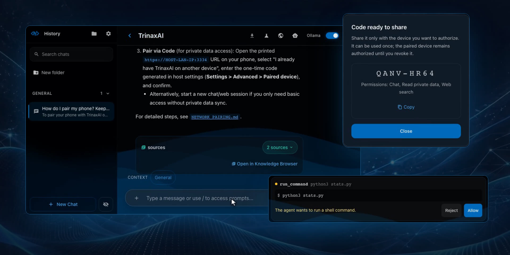
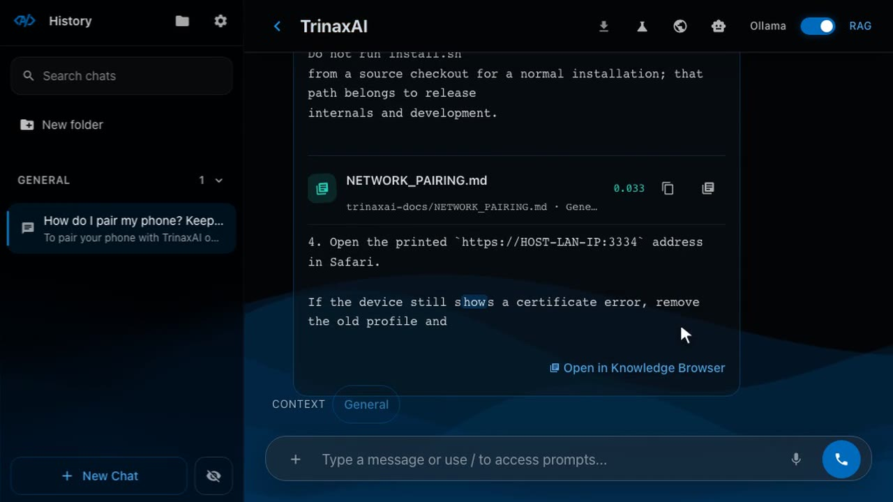
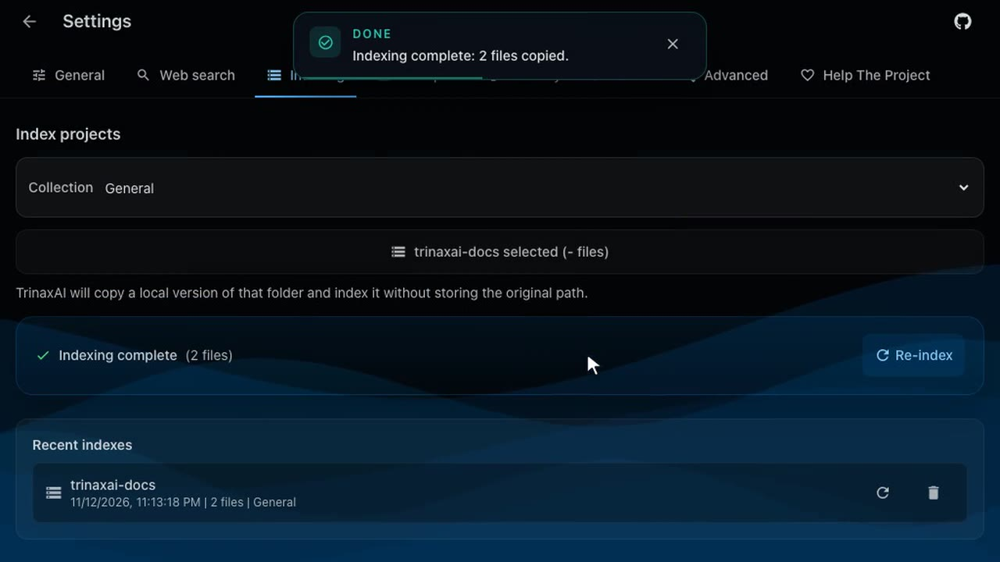
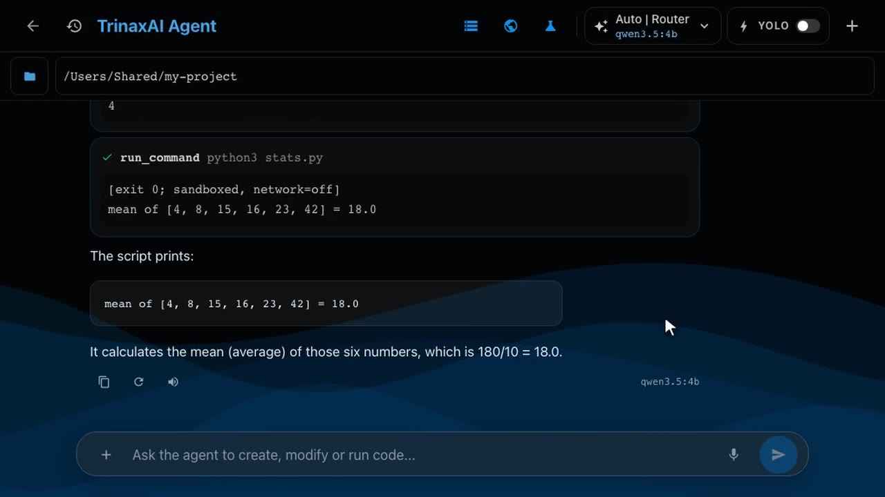
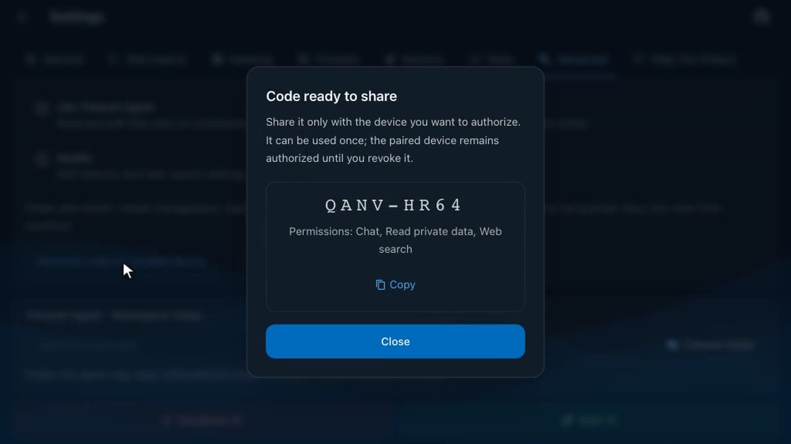

<h1 align="center">
  <a href="https://www.trinaxai.app/"></a>
</h1>

<p align="center">
  <a href="https://github.com/TrinaxCode/TrinaxAI"></a>
  <a href="https://github.com/TrinaxCode/TrinaxAI/releases/latest"></a>
  <a href="https://www.npmjs.com/package/trinaxai"></a>
  <a href="https://github.com/TrinaxCode/TrinaxAI/actions/workflows/ci.yml"></a>
  <a href="https://github.com/TrinaxCode/TrinaxAI/blob/main/LICENSE"></a>
  
</p>

<p align="center"><sub><strong>English</strong> · <a href="README.es.md">Español</a></sub></p>

<p align="center">
  <strong>A private, local-first assistant for your files, research, and code.</strong><br/>
  Ask questions and get answers that cite the file they came from, index folders, let a coding agent work in a workspace you approve, and pair your phone. It all runs on your own computer.
</p>

<h3 align="center"><a href="#install"><ins>Install TrinaxAI</ins></a> &nbsp;·&nbsp; <a href="https://www.trinaxai.app/"><ins>Website</ins></a> &nbsp;·&nbsp; <a href="docs/README.md"><ins>Documentation</ins></a></h3>

<p align="center">
  
</p>

```bash
npm install -g trinaxai@latest
trinaxai setup
```

TrinaxAI keeps inference and indexed data on the configured host unless you
explicitly choose a remote service. It combines local chat, cited
retrieval-augmented generation (RAG), optional web research, a
workspace-confined coding agent, a terminal interface, and an installable
progressive web app (PWA).

## Features

<table>
<tr>
<td width="38%" valign="middle">

### Ask your files

Ask in plain language and get an answer that cites the file it came from. Open the cited source to check it before you rely on the answer.

[Docs →](docs/CLI_REFERENCE.md#chat-and-queries)

</td>
<td width="62%">
  <a href="docs/CLI_REFERENCE.md"><picture><source srcset="docs/assets/readme/features/ask.en.webp" type="image/webp"></picture></a>
</td>
</tr>
<tr>
<td width="38%" valign="middle">

### Index a folder

Point TrinaxAI at a folder and follow its measured progress step by step. Re-indexing is incremental, so only what changed is processed again.

[Docs →](docs/CLI_REFERENCE.md#indexing-and-exploration)

</td>
<td width="62%">
  <a href="docs/CLI_REFERENCE.md"><picture><source srcset="docs/assets/readme/features/index.en.webp" type="image/webp"></picture></a>
</td>
</tr>
<tr>
<td width="38%" valign="middle">

### An agent that asks first

A coding agent that works in a workspace you approve. Dangerous actions wait for your Allow or Reject. Its terminal tool runs in a networkless OS sandbox (bubblewrap on Linux, Seatbelt on macOS) and stays disabled on Windows; the file tools work everywhere.

[Security guide →](docs/SECURITY.md)

</td>
<td width="62%">
  <a href="docs/SECURITY.md"><picture><source srcset="docs/assets/readme/features/agent.en.webp" type="image/webp"></picture></a>
</td>
</tr>
<tr>
<td width="38%" valign="middle">

### Use it from your phone

Turn on network access, generate a one-time code on the host, and pair another device. Each device gets only the permissions you grant, and you can revoke it later.

[LAN pairing →](docs/NETWORK_PAIRING.md)

</td>
<td width="62%">
  <a href="docs/NETWORK_PAIRING.md"><picture><source srcset="docs/assets/readme/features/pair.en.webp" type="image/webp"></picture></a>
</td>
</tr>
</table>

<sub>The animations are real recordings of the TrinaxAI web app, sped up in the quiet parts. Small local models can be wrong; see [known limits](#known-limits).</sub>

**Also in the box:**

- **[Local models sized to your machine](#models-and-hardware)**: setup detects CPU, memory, GPU, and VRAM and picks an `8gb`, `16gb`, `32gb`, or `64gb` profile. The `8gb` profile works with CPU-only hardware.
- **Task-aware routing**: local Ollama chat with routing for chat, code, reasoning, and math.
- **Hybrid RAG**: search over code and documents with citations, collections, and incremental indexing.
- **Deep research**: `trinaxai research "..." --depth 2`, and add `--web` to ground it on web search.
- **Web search, memory, voice, and vision**: all optional.
- **A terminal interface**: chat, indexing, research, diagnostics, and exports from any directory.
- **An installable PWA**: HTTPS, for desktop and mobile, with scoped device pairing.
- **English and Spanish**: the installer and the app.
- **Health checks**: `trinaxai doctor` and `trinaxai status` check the installation and its services.

---

## Models and hardware

Setup chooses a model profile from available memory and GPU resources:

| Profile | Chat and code | Fast responses | Embeddings |
| --- | --- | --- | --- |
| `8gb` | `qwen3.5:2b` | `qwen3.5:2b` | `qwen3-embedding:0.6b` |
| `16gb` | `qwen3.5:4b` | `qwen3.5:2b` | `qwen3-embedding:0.6b` |
| `32gb` | `qwen3.5:9b` | `qwen3.5:4b` | `qwen3-embedding:4b` |
| `64gb` | `qwen3.5:35b` / `qwen3-coder:30b` | `qwen3.5:4b` | `qwen3-embedding:4b` |

The `8gb` profile works with CPU-only hardware. See the
[configuration reference](docs/CONFIGURATION.md) for model and resource settings.

---

## Install

Use the npm package on Linux, macOS, or Windows. You need Node.js 22 or newer
with npm available in your terminal.

~~~bash
npm install -g trinaxai@latest
trinaxai setup
~~~

The launcher downloads the matching official release, verifies its SHA-256
checksum, and starts the platform setup. The setup flow prepares the backend,
PWA, Ollama, and recommended models.

Setup opens with a welcome and asks for your language (English or Spanish).
It then checks your disk space and connection, asks every optional question up
front (model downloads, start now, autostart, weekly update check, access from
other devices), and shows
an installation plan to confirm before it changes anything. Run
`trinaxai setup` again on an existing installation to repair, update, or
uninstall it.

The npm launcher is the only supported end-user installation path. The
platform scripts in this repository implement the release behind the launcher;
you do not need to download or run them directly.

### Setup options

| Need | Command |
| --- | --- |
| Defer model downloads | `trinaxai setup --no-models` |
| Prepare without starting services | `trinaxai setup --no-start` |
| Let other devices on your network open TrinaxAI (default: this computer only) | `trinaxai setup --lan-access` |
| Choose a hardware profile | `trinaxai setup --profile 16gb` |
| Preview changes | `trinaxai setup --dry-run` |
| Skip the language question | `trinaxai setup --language es` |
| Automate setup | `trinaxai setup --yes` (or `--non-interactive`) |

See [configuration](docs/CONFIGURATION.md) when you need to tune models,
resource limits, or providers.

### Start using TrinaxAI

Run the health check first:

~~~bash
trinaxai doctor
trinaxai status
~~~

Then open [https://localhost:3334](https://localhost:3334). Your browser may
ask you to trust the local certificate on the first visit.

Ask a question about indexed files:

~~~bash
trinaxai ask "Summarize my indexed project" --engine rag
~~~

If you skipped model downloads during setup, run `trinaxai setup` again when
you are ready. Use `trinaxai --help` to see every available command.

### Daily commands

Use the CLI from any directory after setup:

| Goal | Command |
| --- | --- |
| Open the interactive assistant | `trinaxai chat` |
| Ask one question | `trinaxai ask "..." --engine rag` |
| Index a folder | `trinaxai index ./documents` |
| Run deep research (add `--web` to ground it on web search) | `trinaxai research "..." --depth 2` |
| Use the coding agent | `trinaxai agent --workspace .` |
| Check services | `trinaxai status` |
| See or change who can reach TrinaxAI | `trinaxai network` / `trinaxai network off` |
| Start or stop services | `trinaxai start` / `trinaxai stop` |
| Diagnose a problem | `trinaxai doctor --strict` |
| Update the installation | `trinaxai update` |
| Remove TrinaxAI | `trinaxai uninstall` |

---

## Known limits

- Questions about code answered by small local models: the cited sources are
  sometimes wrong or incomplete, so open the cited file before relying on an
  answer.
- `trinaxai research` is slow on a CPU-only computer.
- Not measured: the full flow (install, chat, RAG, agent, web app) on Windows,
  on a GPU, and with large models. macOS and Windows are covered by the automated
  CI checks, not by end-to-end runs.

## Privacy and security

TrinaxAI binds local services to loopback by default. Ollama is not exposed as
a generic proxy. LAN browsers must pair with a one-time code and receive only
the capabilities you grant, device by device. You can let a specific device
index, use the Agent, or modify data; power, model management, device pairing,
factory reset and Agent auto-approve (YOLO) always remain host-only.

Keep ports `3333` and `11434` private, protect `storage/.proxy_secret`, and
use a VPN instead of exposing the host to the public Internet. Read the
[security guide](docs/SECURITY.md) and [LAN pairing guide](docs/NETWORK_PAIRING.md)
before enabling another device.

---

## Documentation

| You want to… | Read |
| --- | --- |
| Install, update, or remove TrinaxAI | [Documentation hub](docs/README.md) |
| Configure models, RAG, networking, or limits | [Configuration](docs/CONFIGURATION.md) |
| Look up an environment variable | [Environment variables](docs/ENVIRONMENT_VARIABLES.md) |
| Use every CLI command | [CLI reference](docs/CLI_REFERENCE.md) |
| Understand the architecture | [Architecture](docs/ARCHITECTURE.md) |
| Integrate the HTTP API | [API reference](docs/API_REFERENCE.md) |
| Recover from an error | [Troubleshooting](docs/TROUBLESHOOTING.md) |
| Pair another device | [LAN pairing](docs/NETWORK_PAIRING.md) |
| Develop or contribute | [Developer guide](docs/DEVELOPER_GUIDE.md) |

The PWA also exposes these guides under **Settings → Documentation**.

## Community and support

- **Questions and ideas:** [GitHub Discussions](https://github.com/TrinaxCode/TrinaxAI/discussions).
- **Bugs and feature requests:** [open an issue](https://github.com/TrinaxCode/TrinaxAI/issues). Run `trinaxai doctor --strict` first and read the [support guide](docs/SUPPORT.md).
- **Security reports:** follow the [security policy](docs/SECURITY.md).
- **Follow along:** [star the repository](https://github.com/TrinaxCode/TrinaxAI) and watch the [changelog](docs/CHANGELOG.md) and [releases](https://github.com/TrinaxCode/TrinaxAI/releases).

## Development

This section is for contributors working from a source checkout. End users
should use the npm installation above.

~~~bash
git clone https://github.com/TrinaxCode/TrinaxAI.git
cd TrinaxAI
python3 -m venv .venv
source .venv/bin/activate
pip install -r requirements.lock
(cd chat-pwa && npm ci && npm run dev)
~~~

Run `make check` before submitting a change. See the
[contributing guide](docs/CONTRIBUTING.md) for the full workflow.

## License

TrinaxAI is licensed under AGPL-3.0-or-later. See [LICENSE](LICENSE) and the
[trademark guide](docs/TRADEMARK.md).

Built by [TrinaxCode](https://github.com/TrinaxCode) ·
[trinaxai.app](https://www.trinaxai.app/)
